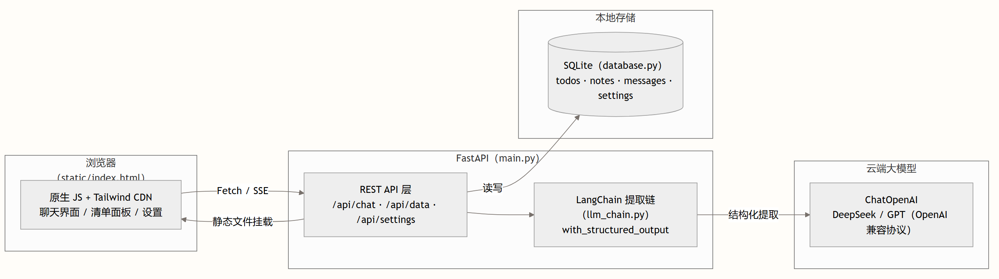
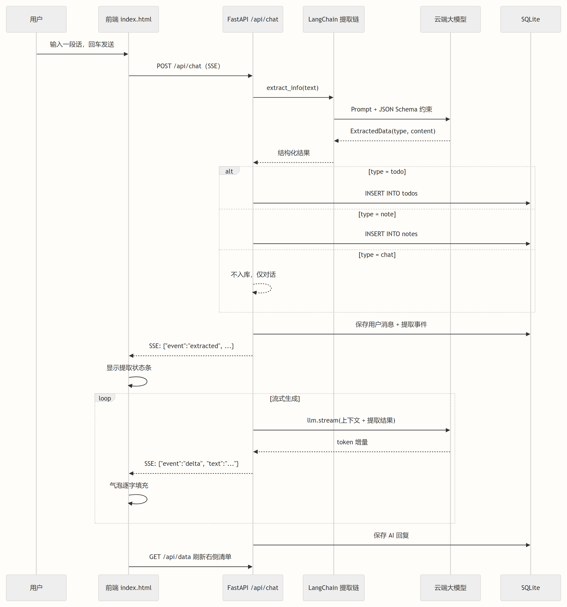
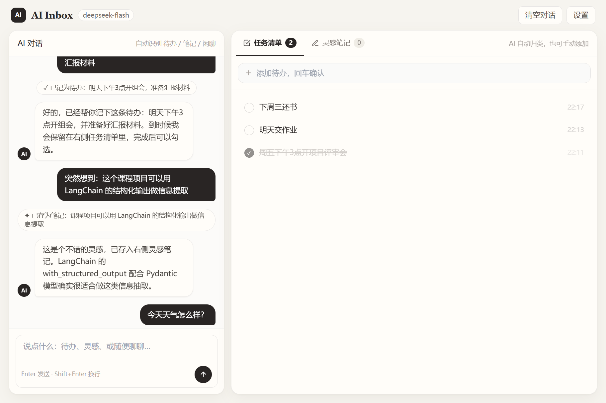
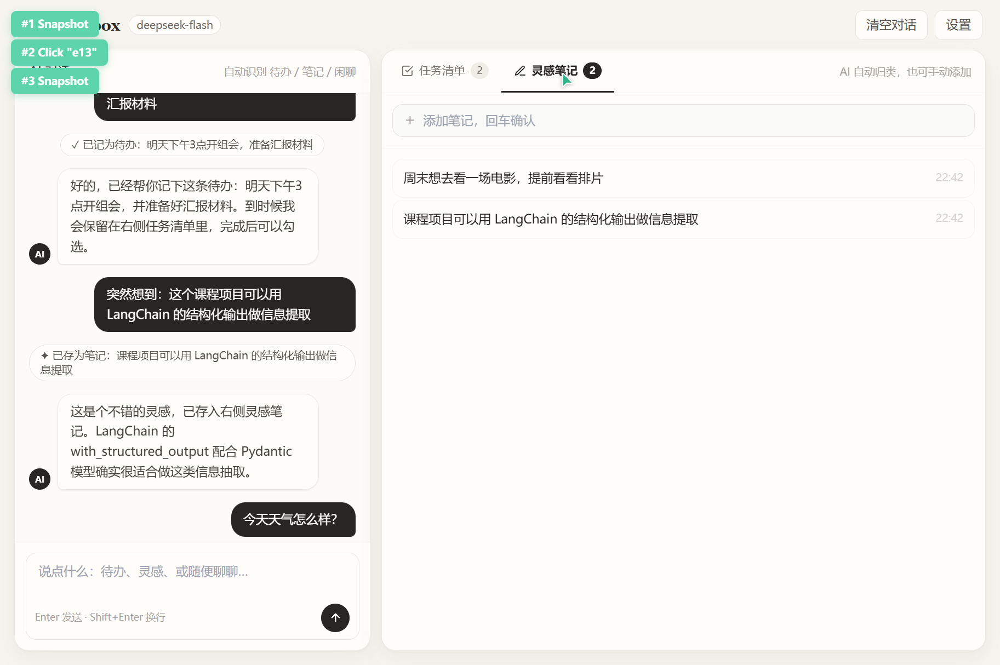

# AI Inbox — 基于 LangChain 与云端大模型的个人智能收件箱

**开源软件课程作业 · 项目报告**

技术栈：FastAPI · LangChain · SQLite · 原生 HTML/JS ｜ 模型：DeepSeek（OpenAI SDK 兼容） ｜ 日期：2026-10-30

## 1 项目简介

**AI Inbox（个人智能收件箱）**是一个"想到什么就说什么"的信息收纳工具。用户在一个对话框里随意输入——可以是待办事项、一闪而过的灵感，或纯粹一句闲聊——系统在后台自动完成三件事：**理解语义、结构化提取、分类入库**。

项目严格遵循"纯云端 LLM + 极简工程"的约束：不使用任何本地模型，不引入 Vue/React 等前端框架，仅用 FastAPI + LangChain + SQLite + 单文件原生 HTML 完成全部功能。核心价值在于用 LangChain 的 `with_structured_output` 能力，把**非结构化的自然语言**可靠地转换为**可存储、可管理的结构化数据**。

项目规模：核心源文件 7 个；输入三分类（待办/笔记/闲聊）；12+ 个 REST API 接口；0 前端框架依赖。

## 2 需求分析与功能设计

产品形态围绕"一个大输入框"展开，功能按「对话区」与「数据管理区」两条线设计。

| 功能模块 | 功能点 | 说明 |
|---|---|---|
| 智能对话 | 流式回复 | SSE（Server-Sent Events）协议逐字输出，带打字动画 |
| 智能对话 | 语义三分类 | 待办 / 笔记 / 闲聊，闲聊只回复不入库，避免"说什么都记录" |
| 智能对话 | 提取状态条 | 对话流内实时显示「已记为待办 / 已存为笔记 / 闲聊·不记录」 |
| 智能对话 | 对话持久化 | 全部消息存入 SQLite，刷新不丢失，支持一键清空 |
| 任务清单 | AI 自动捕获 | 从对话中提取待办并去除冗余（"帮我记一下明天买牛奶"→"明天买牛奶"） |
| 任务清单 | 手动增删改 | 输入框回车快速添加；双击行内编辑；两步点击删除确认 |
| 任务清单 | 完成切换 | 圆形勾选切换完成态，完成项置灰划线并沉底 |
| 任务清单 | 未完成计数 | 标签页徽章实时显示未完成数量 |
| 灵感笔记 | AI 自动捕获 | 识别对话中有记录价值的信息（想法、灵感、备忘） |
| 灵感笔记 | 手动增删改 | 与任务清单一致的手动管理能力 |
| 系统设置 | 模型热配置 | 页内设置面板配置 API Key / Base URL / 模型名，保存即生效，无需重启 |

## 3 系统架构

系统采用经典的**前后端同构单体架构**：FastAPI 同时承担 API 服务与静态文件托管，前端为单文件原生 HTML，数据层使用 SQLite 内嵌数据库，LLM 调用通过 OpenAI SDK 兼容协议访问云端模型。



| 分层 | 技术选型 | 职责 |
|---|---|---|
| 前端展示 | 原生 HTML/JS + Tailwind CDN | 单文件界面，Fetch API 交互，SSE 流式渲染 |
| 接口服务 | FastAPI + Uvicorn | REST API、SSE 流式响应、静态文件托管 |
| 智能层 | LangChain + langchain-openai | 结构化提取链，Pydantic 约束输出 |
| 大模型 | DeepSeek（OpenAI 兼容） | 纯云端推理，无本地模型 |
| 数据持久化 | SQLite3（Python 内置） | todos / notes / messages / settings 四张表 |
| 配置管理 | python-dotenv + DB 设置表 | .env 兜底，页内设置热更新优先 |

## 4 核心流程

一次对话输入的处理链路是本项目最核心的设计。它把"结构化提取"与"流式对话"两条链路合并为一次请求：先判定语义类型并入库，再基于提取结果生成流式回复。



## 5 界面展示

界面采用**暖白纸质感**设计：米白底色、纸白卡片、暖灰文字，全程黑白灰三色、无任何彩色装饰，风格克制干净。布局为「左对话 + 右清单」双卡片结构，右卡片内以标签页切换任务清单与灵感笔记。





细节设计：待回复时显示三点打字动画；提取结果以居中状态条呈现，用户随时知道 AI「记了什么、没记什么」；所有删除/清空操作采用两步点击确认加页面内 toast 提示，不依赖原生弹窗，兼容禁用 prompt/confirm 的嵌入式浏览器环境。

## 6 关键实现

### 6.1 Pydantic 模型驱动的结构化提取

用 `Literal` 将输出约束为三个互斥类型，配合字段级 `description` 提示模型如何清洗内容，这是"说话不必正式，记录自动整洁"的关键。

```python
from typing import Literal
from pydantic import BaseModel, Field

class ExtractedData(BaseModel):
    """从用户输入中提取出的结构化信息"""
    type: Literal["todo", "note", "chat"] = Field(
        description="信息类型：todo=待办任务；note=值得记录的想法/信息；chat=纯闲聊提问（不记录）"
    )
    content: str = Field(
        description="提取的核心内容，去除语气词和冗余；chat 类型给空字符串"
    )

structured_llm = llm.with_structured_output(ExtractedData)
```

### 6.2 SSE 流式对话

后端以 `StreamingResponse` 推送标准 SSE 事件流，先发 extracted 事件驱动状态条，再逐 token 推送 delta，协议结构化、可扩展。

```python
def generate():
    yield _sse({"event": "extracted", "type": result.type, "content": result.content})
    reply = ""
    for chunk in stream_reply(text, result, history):
        reply += chunk
        yield _sse({"event": "delta", "text": chunk})
    if reply.strip():
        database.add_message("assistant", reply)
    yield _sse({"event": "done"})

return StreamingResponse(generate(), media_type="text/event-stream")
```

### 6.3 配置热更新

模型配置存于 SQLite settings 表，读取时数据库优先、.env 兜底；保存后重建提取链即时生效，配合页内设置面板实现"不改代码、不重启服务"切换模型。

## 7 测试与验证

开发过程中对关键路径做了系统性的接口实测与浏览器端到端验证。

| 测试项 | 输入 / 操作 | 预期结果 | 实测 |
|---|---|---|---|
| 待办提取 | "帮我记一下明天要买牛奶" | 入库 todo："明天买牛奶" | 通过 |
| 笔记提取 | "这个产品可以用区块链重新做一遍" | 入库 note | 通过 |
| 闲聊不记录 | "你能帮我做什么" | type=chat，清单无新增，正常回复 | 通过 |
| 流式输出 | 任意输入 | SSE 依次返回 extracted → delta×N → done | 通过 |
| 对话持久化 | 发送消息后刷新页面 | 气泡与状态条从数据库完整恢复 | 通过 |
| 手动管理 | 增删改、完成切换 | 列表实时刷新，计数徽章同步 | 通过 |
| 异常兜底 | 空输入 / 未配置 Key / 网络异常 | 400 / 502 + 中文提示，无裸堆栈 | 通过 |
| UI 兼容 | 禁用原生弹窗的环境 | 行内编辑、两步确认、toast 全可用 | 通过 |

## 8 从零运行

1. 安装依赖：`pip install -r requirements.txt`
2. 配置密钥：复制 `.env.example` 为 `.env`，填入 `OPENAI_API_KEY`（也可启动后在页面右上角"设置"中填写，保存即生效）
3. 启动服务：`uvicorn main:app --reload`
4. 访问应用：浏览器打开 `http://127.0.0.1:8000/`

```
# .env 配置示例
OPENAI_API_KEY=sk-xxxxxxxxxxxxxxxx
OPENAI_BASE_URL=https://api.deepseek.com/v1
MODEL_NAME=deepseek-chat
```

## 9 总结与展望

本项目以约七百行代码完成了一个端到端可用的 AI 信息收纳工具：LangChain 结构化输出解决了"自然语言 → 结构化数据"的可靠性问题，SSE 流式协议保证了对话体验，SQLite 持久化让数据可积累、可管理，极简前端则把维护成本压到最低。

可扩展方向：① 待办增加截止时间字段，由 LLM 一并抽取并支持到期提醒；② 引入 LangChain Retrieval，对历史笔记做语义检索与"回忆"问答；③ 增加多用户与登录，SQLite 平滑迁移至 PostgreSQL。

仓库地址：https://github.com/IA3001/langchain-demo-3
